# Ticket #149 — Documents et questions des entraînements/examens lisibles et visuels

- **Ticket** : [#149 — P0 — Rendre les documents et questions des entraînements/examens lisibles et visuels](https://github.com/ReC82/jury-central/issues/149)
- **État réel** : **Installé — à tester** (correction du 22/10 suite au retour du propriétaire ; restent les points du lot 1 listés plus bas)
- **Branche** : `feature/149-supports-visuels` — **SHA installé** : `b0363fc8d2d94f677f220c211002393a70758c2a` (PR #188)
- **Dates** : lot 1 le 2026-10-21 ; correction des pages de média et du cadre commun le 2026-10-22

## 0. Correction du 22/10 — retour du propriétaire (supports médiatiques non validés)

### 0.1 Constat et cause prouvée

Retour : quiz FSE02, question de classement — supports fondus dans la page, titre répété,
textes collés (« L'HEBDO DU LITTORALAbonnez-vous », « numérique14 € par mois », « seule9 € »),
tarifs en texte brut, très grands titres.

Diagnostic dans un vrai navigateur (Chromium, page complète du quiz connecté, base
temporaire) :

1. Le site sert bien la bonne feuille `design-system.css` (contenu identique à celui
   installé, règles `.jc-sd-web…` présentes) **mais sans `Cache-Control` ni version dans
   l'URL** (`/static/css/design-system.css`, seulement `Last-Modified`/`ETag`). Un
   navigateur applique alors un cache heuristique : il peut réutiliser pendant des heures,
   voire des jours, une copie ancienne sans revérifier.
2. Rendu de la page réelle du quiz avec la feuille **d'avant #149** (version du ticket #148,
   sans aucune règle `.jc-sd`) : Chromium produit **exactement** les textes cités —
   `L'HEBDO DU LITTORALAbonnez-vous`, `Édition papier + numérique14 € par mois`,
   `Édition numérique seule9 € par mois` — et des titres de document à 32 px, support sans
   fond ni contour, titre affiché deux fois (titre + barre d'adresse). Capture :
   
3. Le HTML n'avait aucun espace entre le nom du média et son slogan, ni entre formule et
   prix : sans la feuille, les mots se collent.

Conclusion : nouveau HTML + feuille périmée dans le navigateur. Je ne peux pas inspecter le
cache de ton navigateur ; la preuve est la reproduction exacte des symptômes et l'absence de
contrôle de cache. **Même avec la bonne feuille**, la composition restait insuffisante
(capture « avant » ci-dessous : trois cartes imbriquées, titre trois fois, offres
peu lisibles) — elle est aussi corrigée.

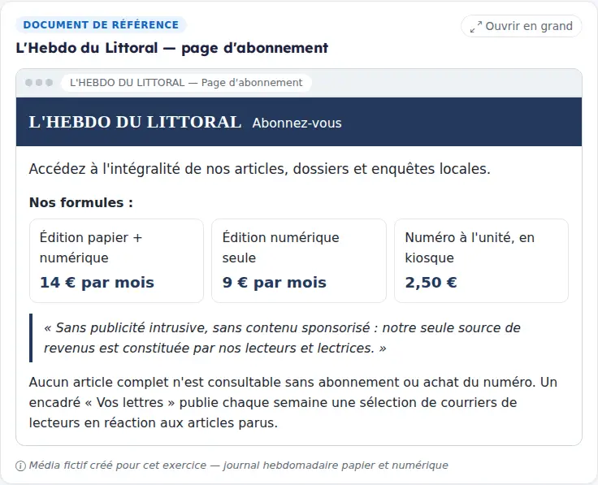

### 0.2 Corrections (composants partagés : entraînement, examen blanc, quiz, résultats, page document)

- **Feuilles de style et scripts versionnés** : chaque CSS/JS local est appelé avec
  `?v=<empreinte du contenu>` (`asset_version`, `app/templating.py`) dans `base.html` et les
  pages qui chargent leurs propres scripts. Après chaque installation, l'URL change : le
  navigateur charge forcément la nouvelle version.
- **Cadre commun allégé** : le document n'est plus une carte. En haut, l'interface
  (étiquette « Document de référence », titre en petit, « Ouvrir en grand ») ; dessous, le
  **support autonome** sur feuille claire, contour et ombre discrets. Les supports qui sont
  déjà un objet complet (page web, affiche, note sur papier à en-tête, forum, mails,
  témoignages) ne sont plus posés sur une deuxième feuille.
- **Page de média** (`webpage`) : fenêtre de site avec barre d'adresse neutre (le titre
  n'est plus recopié), en-tête du média distinct (nom + slogan), contenu aéré.
  - *L'Hebdo du Littoral* : trois **cartes d'offre** (formule, prix en grand, périodicité
    « par mois » à côté ; le numéro à 2,50 € sans périodicité car le texte n'en donne pas),
    citation éditoriale, ligne « accès réservé » avec cadenas, **zone « Vos lettres »**.
  - *Le Flash Infos* : bandeau rouge, mention « Tous nos articles sont accessibles
    gratuitement, sans inscription », bannière du haut, **colonne « À la une »** (titre,
    phrase sur compteur de vues / « Partager » / commentaires avec leurs icônes, sans aucun
    chiffre) et **bannière latérale**, puis pied « modèle économique ».
  - *RCW* et les nouvelles pages (#129, ex. Vallée FM) profitent du même composant.
- **Robustesse sans CSS** : espaces explicites dans le HTML ; même une feuille absente ne
  colle plus les mots.
- **Téléphone** : offres empilées (prix à droite), colonnes du site d'information
  empilées. **Impression** : supports sans ombre, couleurs d'en-tête conservées, offres non
  coupées.
- Aucun texte inventé : chaque fragment affiché reste un extrait exact de la version du
  document (test de fidélité existant, toujours vert) ; aucune donnée ni question modifiée,
  pas de seed.

### 0.3 Tester (SHA `b0363fc`)

Connecte-toi, puis recharge une fois la page (l'URL des feuilles a changé, rien à vider).

- Quiz FSE02 : https://jury-central.lodylands.com/quiz → chapitre FSE02 → question de
  classement des trois médias.
- Entraînement FSE02 : https://jury-central.lodylands.com/uaa/fse-fse02/practice
- Examen blanc FSE16 (autres supports) : https://jury-central.lodylands.com/uaa/fse-fse16/exam
- « Ouvrir en grand » depuis un document (page `/documents/…`, bouton Imprimer).

Captures (Chromium, page complète connectée, serveur local sur base temporaire avec le
contenu FSE du dépôt) :

| | |
|---|---|
| Quiz FSE02 desktop  | Quiz FSE02 mobile  |
| Entraînement FSE02 (Vallée FM) 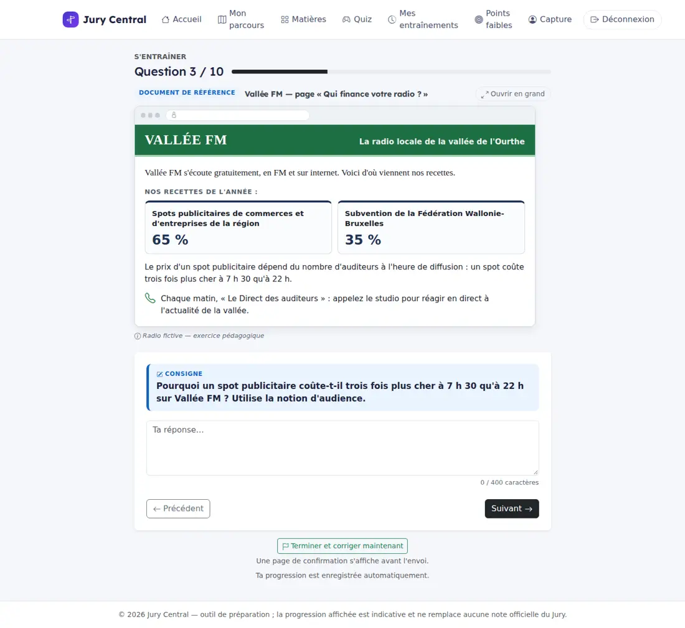 | Ouvrir en grand  |
| Impression (Flash Infos) 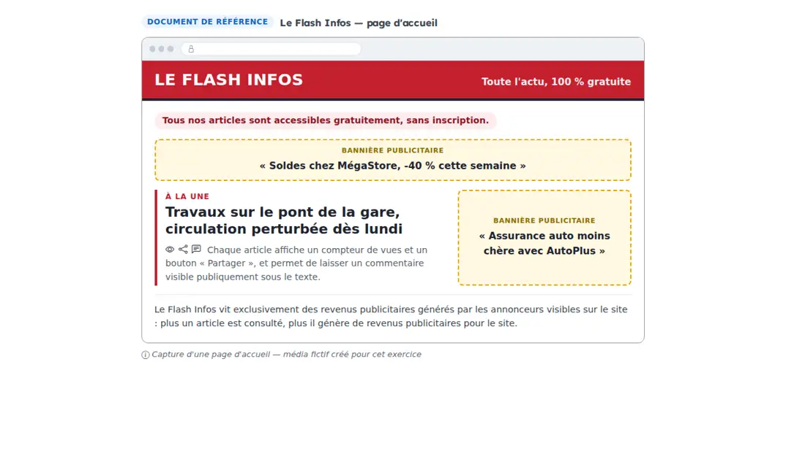 | Autres supports (mail, notes, forum, réactions, fiches) 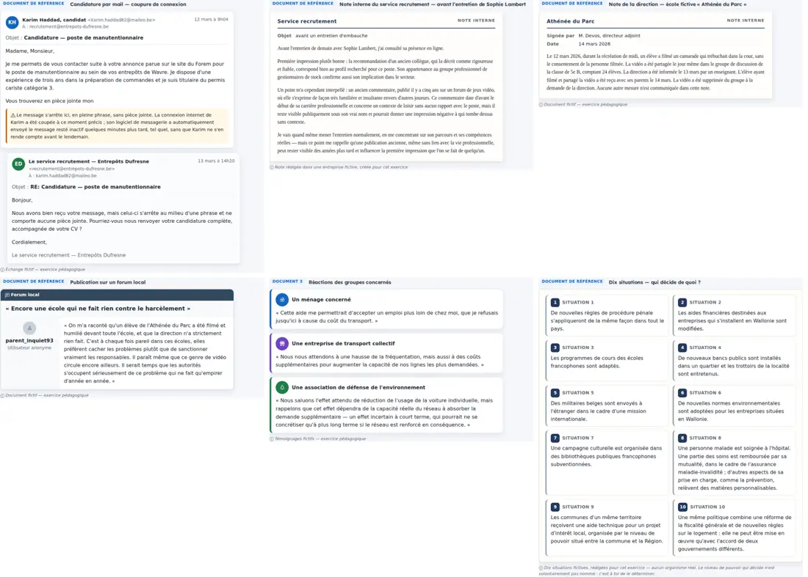 |

### 0.4 Vérifications

- Page complète en vrai navigateur : quiz FSE02 desktop 1366 px et mobile 390 px,
  entraînement FSE02 (3 questions), « Ouvrir en grand », impression (rendu `print` + PDF),
  les 30 pages `/documents/{id}` FSE en desktop examinées.
- Tests : `tests/test_ticket149_document_layouts.py` (73, dont 4 nouveaux : découpage du
  prix, page d'abonnement, page d'accueil, URL versionnées) + tickets 47, 77, 79, 97, 129,
  136, 137, 148, 153, 22, menu mobile : **370 passed**. `ruff check` des fichiers Python
  modifiés : OK. Pas de suite complète (pas de modification du moteur partagé).
- Installation : services actifs, `/health` OK local et public, la page sert
  `design-system.css?v=e37e95a389` avec les nouvelles règles, compteurs 18/74/587 identiques
  avant/après, sauvegarde de la base faite avant installation.
- Non effectué : capture sur le site public lui-même (pas de compte de test ; je ne crée ni
  ne modifie de compte réel) ; rendu Safari/Firefox non testé.

### 0.5 Choix faits seul

1. Version d'URL par empreinte du contenu plutôt qu'un en-tête `Cache-Control` : ce dernier
   relève de nginx (infrastructure, interdit ici) ; l'empreinte suffit et ne change que si
   le fichier change.
2. Prix découpé en « montant + périodicité » à partir du texte exact (« 14 € » + « par
   mois ») ; aucune périodicité ajoutée au numéro à l'unité.
3. Le paragraphe final de chaque page découpé en zones (accès réservé / « Vos lettres » ;
   gratuité / outils de l'article / modèle économique) : phrases exactes, ordre de lecture
   conservé, test de fidélité vert.
4. Pas d'image ni de chiffre ajoutés (compteur de vues représenté par une icône, sans
   nombre) ; mention fictive inchangée, discrète sous le support.
5. Barre d'adresse neutre (cadenas seul) plutôt qu'un faux nom de domaine.

### 0.6 Décisions demandées au propriétaire

Aucune nouvelle décision nécessaire pour cette correction. Les questions du lot 1 (§ 7)
restent ouvertes.

---

## 1. Synthèse

Les documents d'entraînement, d'examen blanc, de quiz, de résultats et la page « document »
ne sont plus des blocs de texte brut à ascenseur interne. Un composant unique les affiche
selon leur vraie nature : mail, affiche, publication de réseau social ou de groupe public,
page de média, forum, conversation de groupe, note sur papier à en-tête, fiches numérotées,
tableau, budget, circuit économique, chaîne de flux, bulletins de vote.

Les **30 documents FSE installés** (tous ceux qui contenaient des crochets éditoriaux) ont
chacun une mise en page dédiée. Les 31 documents de Français (articles, textes longs) gardent
un rendu générique lisible, sans ascenseur : c'est leur vraie forme (texte suivi), mais
certains (lettre, courriel, note de service) méritent un gabarit dédié au lot suivant.

Le texte affiché est **mot pour mot** celui de la version du document ; un test le vérifie
pour chaque fragment et contrôle que le contenu est couvert. Aucune base, aucune question,
aucune session n'a été modifiée.

## 2. Matrice de couverture (supports installés)

| Famille | Documents (titre court) | Forme choisie | Composant | Couverture |
|---|---|---|---|---|
| Mail / fil de mails | FSE01 candidature coupée + réponse | Deux messages (avatar, De/À/date, objet, corps, signature), encadré « ce qui s'est passé » hors du mail | `email_thread` | Fait |
| Affiche | FSE01 affiche sécurité routière | Affiche déjà composée du cours (image générée, slogan HTML, QR réel) + légende descriptive exacte | `poster` (réutilise `FSE01_AFFICHE_CARD_HTML`) | Fait (voir question 2) |
| Publication réseau social | FSE01 offre d'emploi | Carte de publication, compteurs exacts, commentaires en bulles, réponse indentée | `social_post` | Fait |
| Publication de groupe public | FSE04 « Fous rires du quotidien » | En-tête de groupe (public, 2 400 membres), publication, vidéo **non reproduite** (cadre statique sans faux lecteur + description), 340 partages, membres A–E avec avatars/couleurs distincts | `social_post` | Fait |
| Pages de média | FSE02 Hebdo du Littoral, Flash Infos, RCW | Page web (barre de navigateur, bandeau du média, formules, bannières publicitaires, mission) | `webpage` | Fait |
| Éléments retrouvés en ligne | FSE03 Sophie Lambert | 5 fiches numérotées, vignettes déjà existantes (portrait, anniversaire, zoom) ou icône | `findings` | Fait |
| Note / proposition / document daté | FSE03 note RH, FSE07 note de direction, FSE14 document daté, FSE16 proposition et note budgétaire | Papier à en-tête (organisme, type, métadonnées), paragraphes, points numérotés | `memo` | Fait |
| Forum | FSE07 forum local | Interface de forum : barre du forum, sujet, colonne auteur (avatar anonyme, `parent_inquiet93`, « Utilisateur anonyme »), message. **Aucune date, aucun like, aucune réponse inventés** | `forum_post` | Fait |
| Conversation de groupe | FSE07 classe de 5e B | Fil de messages, séparateur de jour, couleur par personne | `chat` | Fait |
| Témoignages | FSE04 Karim, FSE16 trois réactions | Cartes empilées (icône d'acteur, couleur, citation) — jamais 3 colonnes étroites | `quotes` | Fait |
| Situations / scénarios / extraits / affirmations / propositions | FSE05, FSE06, FSE09, FSE11 (×2), FSE13, FSE08 (affirmations) | Fiches numérotées à numéros stables ; **fiches visées par la question mises en avant**, dossier complet dans « Voir tout le document » | `cards` | Fait |
| Tableaux | FSE08 niveaux de pouvoir, FSE10 scrutins, FSE14 organismes | Vrai tableau HTML ; empilé en fiches sur téléphone | `table` | Fait |
| Budget chiffré | FSE12 recettes/dépenses | Deux tableaux à montants alignés | `budget` | Fait |
| Schéma de circuit | FSE15 quatre agents | 4 cartes d'agents + liste des flux avec flèches | `circuit` | Fait |
| Exemple de flux | FSE15 aide publique au média | Cas concret + chaîne État → média → employés, puis « consommer » / « payer des impôts → État » | `flow_chain` | Fait |
| Bulletins de vote | FSE10 quatre bulletins | Bulletins dessinés en HTML/CSS (cases cochées, griffonnage en marge) + description exacte | `ballots` | Fait |
| Articles / textes longs (Français) | 31 documents | Texte exact, paragraphes respectés, largeur de lecture, sans ascenseur | rendu générique | Fait (gabarits dédiés lettre/courriel/note : reste) |

## 3. Changements réalisés

- `app/v1/document_layouts.py` (nouveau) : registre des 30 mises en page, liées au **titre
  exact et à l'empreinte du texte exact** de la version ; `resolve_layout` (1. `content_json
  ["layout"]` pour un nouveau document structuré, 2. registre), `display_heading` (numéro
  réel « Document 3 »), `focus_numbers` (fiches visées), `generic_parts` (rendu générique),
  outils de vérification (`verification_corpus`, `iter_content_strings`).
- `app/templates/_document_layouts.html` (nouveau) : un composant par nature de document +
  cadre commun (étiquette, titre, « Ouvrir en grand », mention discrète).
- `app/templates/_source_documents.html` : utilisé par l'entraînement, l'examen et le quiz ;
  documents affichés d'emblée, une seule commande « Ouvrir en grand » (fin du doublon
  « Voir le document » + « Ouvrir dans un nouvel onglet »), plus d'ascenseur `max-height: 50vh`.
- `app/templates/v1_session_results.html` : même composant, replié sous « Revoir le document »
  (déplié automatiquement à l'impression).
- `app/templates/v1_document_view.html` : même composant + bouton Imprimer.
- `app/templates/v1_session_question.html` : colonne élargie quand la question s'appuie sur
  un document ; consigne mise en évidence (« Consigne ») ; zone de réponse un peu plus haute ;
  compteur discret relié au champ (`aria-describedby`, `aria-live`) et toujours fidèle à la
  limite réelle (inchangée) ; « Terminer l'évaluation » en bouton vert avec drapeau, distinct
  de « Suivant », et « Terminer maintenant » en bouton visible — tous deux passent par la page
  de confirmation existante.
- `app/static/css/design-system.css` : section « Documents sources composés (ticket #149) »
  (desktop, téléphone ≤ 576 px, impression).
- `app/static/js/design_system.js` : zoom des visuels dans les documents ; dépliage des
  documents repliés avant impression.
- `app/templating.py` : fonctions exposées aux gabarits ; `app/v1/routes_sessions.py` :
  la version exacte du document est transmise aux résultats.
- Tests : `tests/test_ticket149_document_layouts.py` (nouveau) ; trois anciens tests mis à
  jour parce qu'ils exigeaient précisément ce que le ticket supprime (bouton « Voir le
  document », ascenseur `max-height: 50vh`, format « Document A : titre »).

## 4. Tester

SHA installé : `ec1952a894a210c535c1fac25087bd10c4f817e9`. Connecte-toi d'abord sur le site.

- Examen blanc FSE16 (documents 1/2/3, réactions) : https://jury-central.lodylands.com/uaa/fse-fse16/exam
- Entraînement FSE07 (note, conversation, forum) : https://jury-central.lodylands.com/uaa/fse-fse07/practice
- Entraînement FSE04 (groupe public, témoignage) : https://jury-central.lodylands.com/uaa/fse-fse04/practice
- Entraînement FSE09 (dix situations, fiches visées) : https://jury-central.lodylands.com/uaa/fse-fse09/practice
- Entraînement FSE12 (budget) / FSE15 (circuit, aide au média) : https://jury-central.lodylands.com/uaa/fse-fse12/practice — https://jury-central.lodylands.com/uaa/fse-fse15/practice
- Examen blanc FSE global : https://jury-central.lodylands.com/uaa/fse-fse17/exam
- Quiz (mêmes composants) : https://jury-central.lodylands.com/quiz

Procédure courte : démarrer une session, vérifier que chaque document s'affiche directement
dans sa forme, sans ascenseur interne ni crochets ; « Ouvrir en grand » ouvre la même
présentation dans un onglet (bouton Imprimer) ; terminer la session et vérifier « Revoir le
document » dans les résultats ; refaire sur téléphone (tableaux en fiches, forum en une
colonne).

Captures (navigateur headless Chromium, rendu des composants avec les vraies feuilles de
style ; desktop 1100 px, mobile 390 px) :

| | |
|---|---|
| Mail  | Groupe public 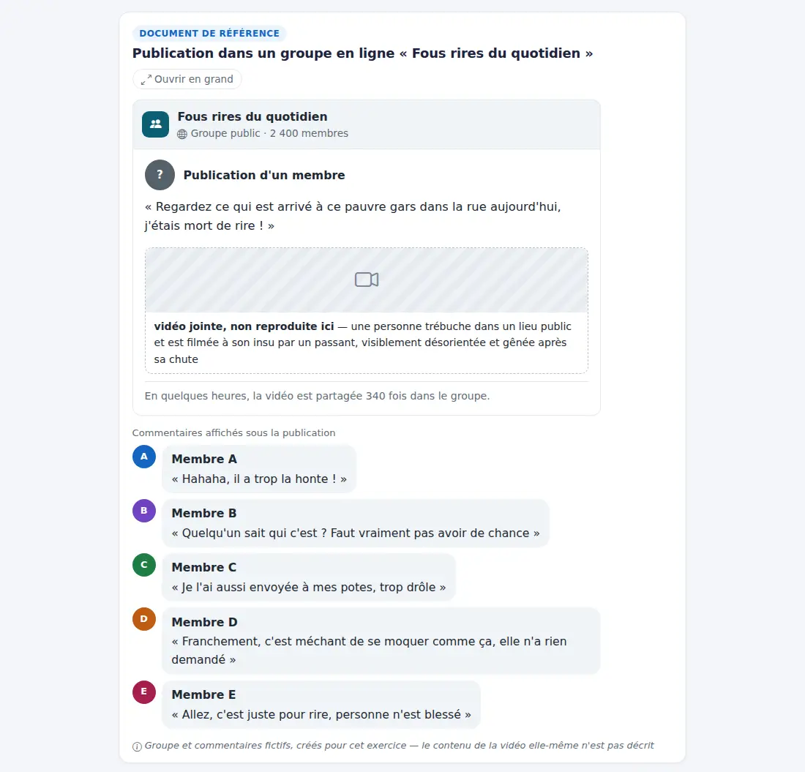 |
| Forum 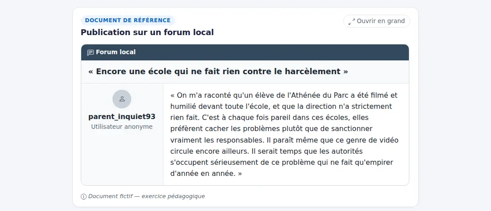 | Réactions (document 3) 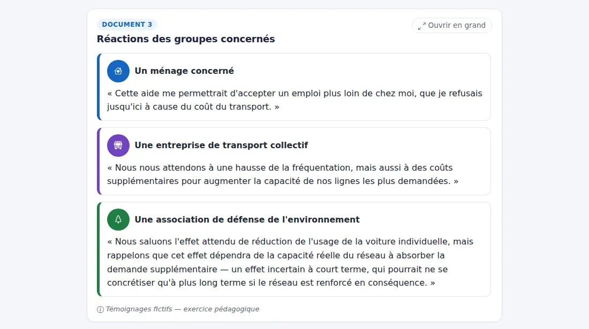 |
| Fiches visées (FSE09) 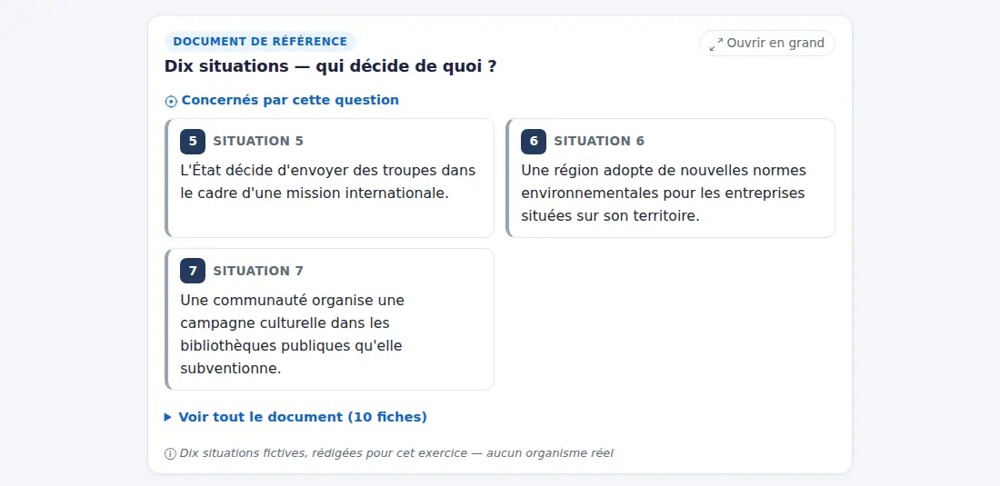 | Budget 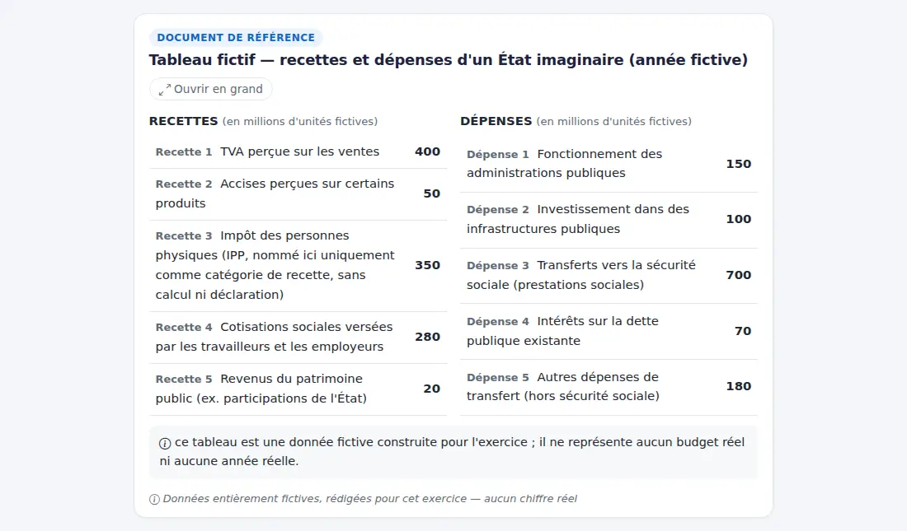 |
| Circuit 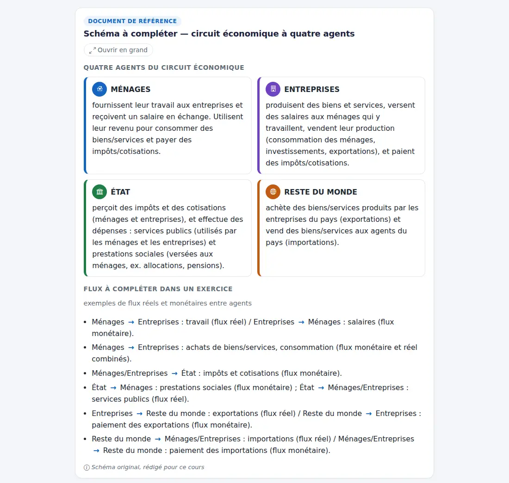 | Aide au média 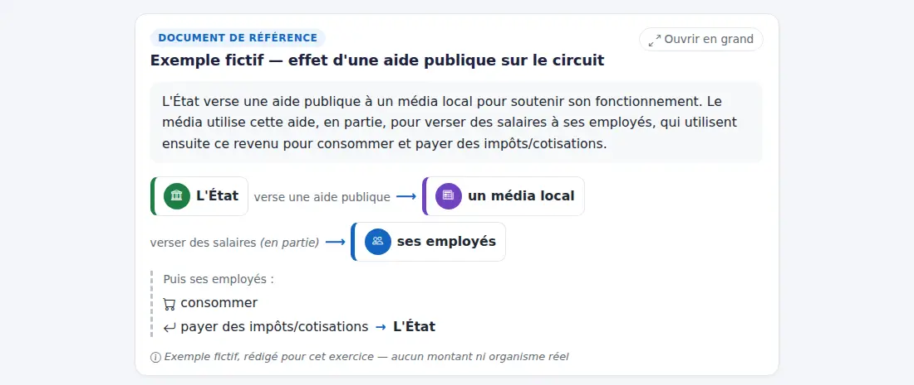 |
| Mobile forum 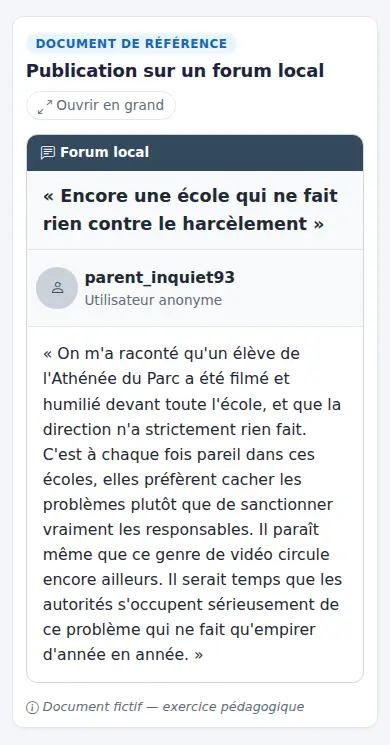 | Mobile tableau 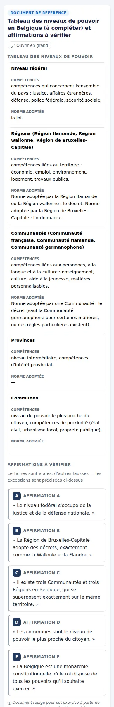 |

Avant : chaque document était un bloc gris `white-space: pre-line`, hauteur bornée à 50 %
de l'écran avec ascenseur, précédé de « [Document fictif…] » et de deux boutons.

## 5. Vérifications

Effectuées :
- Fidélité : pour chacun des 30 documents, chaque texte affiché est un extrait exact du
  titre/texte de la version (hors fragments retirés listés) ; couverture du corps ≥ 95 %
  des mots (en pratique 96–100 %, les écarts sont des libellés rendus par l'interface :
  « Objet », « Sujet », « Posté par ») ; empreintes calculées sur la base réelle (lecture
  seule) identiques à celles des constantes du seed.
- Rendu : aucun crochet ni « voir FSExx » ni fragment retiré dans le rendu des 30 documents ;
  texte modifié → rendu générique ; `content_json.layout` honoré.
- Pages réelles (client de test) : question d'examen FSE16 (« Document 3 », consigne,
  bouton de fin distinct, une seule commande d'ouverture), page document, résultats.
- Tests ciblés : `test_ticket149_document_layouts.py`, `test_ticket79`, `test_ticket77`,
  `test_ticket47`, `test_ticket96`–`test_ticket100` (FSE), `test_ticket137*` (quiz) — verts.
- Suite complète (une fois) : 1864 passed (12 min 51 s).
- `ruff check` des fichiers Python modifiés : aucune erreur.
- Captures desktop/mobile des 30 documents examinées une à une (corrections faites :
  pseudo du forum coupé, témoignages longs en grille déséquilibrée → empilés).

Non effectuées / limites :
- Les captures rendent les composants avec les vraies CSS, mais pas la page complète de
  session du site (la règle interdit de lancer un seed depuis le worktree) ; la page complète
  est vérifiée par les tests HTML et doit être validée visuellement par toi.
- Rien n'a été généré par IA (voir question 3) ; les seuls visuels raster sont ceux déjà
  présents (affiche FSE01, portrait et anniversaire FSE03).

## 6. Choix techniques faits seul

1. **Pas de nouvelle version des documents en base** : les questions référencent la version
   exacte d'un document ; créer une nouvelle version aurait imposé de nouvelles versions de
   ~90 questions. La présentation est donc une couche liée par empreinte au texte exact de la
   version — même version et même rendu pour l'élève, la correction et les anciens
   questionnaires. Aucune donnée modifiée, pas de seed nécessaire.
2. **Mentions entre crochets** : la mention initiale (« document fictif… ») devient une note
   discrète en italique sous le document ; les crochets descriptifs deviennent le support
   correspondant (cadre de vidéo non reproduite, bannières publicitaires, légende d'affiche,
   encadré « ce qui s'est passé » du mail). Les crochets légitimes d'un texte générique sont
   conservés.
3. **Retirés de l'écran élève** (restent dans le texte transmis à la correction, listés dans
   `omitted`) : renvois de cours (« voir FSE02 », « voir FSE09 », « vues en FSE12-13 ») ;
   annotations d'analyse du cas « aide publique au média » (« flux monétaire vers les
   ménages »…) ; totaux et solde du budget FSE12, que deux questions demandent précisément
   de calculer ; queues éditoriales « exemple volontairement présenté comme partagé, sans
   réponse unique trompeuse » (FSE09 situations 8 et 10) ; « Norme adoptée à ce niveau : »
   (reformulé en colonne de tableau).
4. **Conservés volontairement** quand le document EST la source à lire (questions « d'après le
   tableau / le schéma ») : rôles COLLECTEUR/GESTIONNAIRE (FSE14), flux réel/monétaire du
   schéma FSE15, familles politiques des extraits FSE11.
5. **Numéros réels** : FSE16 affiche « Document 1/2/3 » (les consignes disent « d'après le
   document 3 ») ; un titre « Document N — … » est découpé en étiquette + titre ; aucune autre
   numérotation inventée (« Document de référence », « Document A/B » sinon).
6. **Titres affichés** : « Réactions des groupes concernés » (au lieu de « Réactions fictives
   de… », le caractère fictif passe dans la mention) ; « Publication sur un forum local » (le
   titre d'origine annonçait « non datée, auteur non identifié », indices que l'élève doit
   repérer lui-même — l'absence de date et l'anonymat restent visibles dans le forum).
7. **Membres A–E** gardent leur nom exact (les questions les citent) avec avatar et couleur
   distincts ; pas de pseudonymes inventés.
8. **Fiches visées** : détection des numéros cités dans la consigne ou les éléments à classer
   (« situation 5 », « Situation 6 (…) ») ; uniquement si la question vise une partie du
   dossier ; le dossier complet reste accessible avec les mêmes numéros.
9. **Aucun pictogramme qui classe** sur les fiches à classer (seulement le numéro) : une icône
   « région » ou « commune » donnerait la réponse.
10. Icônes : Bootstrap Icons déjà chargées par le socle #136 ; aucune nouvelle dépendance.
11. Limite de 300 caractères et autres limites de réponse : inchangées (le ticket demande de
    ne pas les élargir sans examen).

## 7. Décisions demandées au propriétaire

1. **Indices-réponses dans le texte même de FSE09 « Dix situations »** (« Une région… »,
   « Une communauté… », « Une commune… », et les explications des situations 8 et 10).
   L'écran n'y ajoute plus rien, mais le texte source donne encore le niveau de pouvoir.
   Options : (a) nouvelle version du document avec des descriptions neutres de la décision
   + nouvelles versions des questions qui l'utilisent (avec #152) ; (b) assumer une question
   de lecture facile. **Recommandation : (a), traitée dans #152** (reformulation des
   consignes et des supports).
2. **Affiche FSE01** : l'illustration du cours (réutilisée telle quelle) montre des lettres
   rouges sur fond clair et un enfant en rouge, alors que le texte du document décrit « lettres
   blanches sur fond rouge » et une « silhouette noire ». La légende affichée reste le texte
   exact. Options : (a) régénérer l'illustration conforme au texte (clé API valide
   nécessaire) ; (b) nouvelle version du texte décrivant l'affiche réelle ; (c) laisser.
   **Recommandation : (a)** dès que la clé est valide.
3. **Illustrations générées par IA** : non utilisées ici. Aucun des 30 supports ne l'exigeait
   (texte exact en HTML, schémas/tableaux en HTML précis) ; le seul candidat (vignette de la
   vidéo FSE04) serait une reconstitution — j'ai préféré un cadre statique explicite. La clé
   du serveur était refusée au #136 (401) et les illustrations du parcours sont toujours
   absentes ; je n'ai pas relu la configuration (interdit depuis cette session). **À
   confirmer** : la clé a-t-elle été remplacée ? Si oui, je peux produire les vignettes utiles
   (vidéo FSE04 identifiée « reconstitution », affiche conforme).
4. **Cours FSE** : les cartes réalistes des cours (#115/#118) restent celles d'avant ; certaines
   contiennent des détails absents du document de session (ex. citation du forum de jeux de
   Sophie). Faut-il aligner les cours sur ces nouveaux composants (même document, même rendu
   partout) ? **Recommandation : oui, lot suivant**, document par document, sans changer les
   textes du cours.

## 8. Éléments restant à réaliser

- Gabarits dédiés pour les documents de Français de forme lettre/courriel/note de service
  (« Lettre professionnelle — Demande de congé », « Mini-test — courriel de réclamation »,
  « Texte imparfait 1 — Note de service »…) ; les articles gardent le rendu générique.
- Décisions 1 à 4 ci-dessus (nouvelle version FSE09 avec #152, affiche, illustrations, cours).
- Coordination #151 (références « document N » ambiguës hors FSE16) et #152 (consignes
  autonomes, ex. « Associe maintenant ces trois autres situations ») : non traités ici.
- Composition paginée / export PDF d'un dossier papier : non nécessaire pour les supports
  actuels (impression directe de la page document) ; à envisager si un vrai dossier
  multipage est ajouté.

## 9. Installation (2026-10-21)

- PR #158 fusionnée dans `develop`, installée en avance rapide : `5a72c3c` → `ec1952a`.
- Sauvegarde de la base avant installation (état de l'orchestrateur) ; aucun seed nécessaire
  (aucun contenu seedé modifié) ; aucune dépendance ajoutée.
- Services `jury-central` et `jury-central-correction-worker` redémarrés : actifs ;
  `/health` local et public : `ok` ; pages touchées : 200 ou 303 (connexion requise) ;
  feuille de style servie avec les nouveaux composants ; aucune erreur dans les journaux.
- Compteurs utilisateurs/sessions/réponses : 18 / 71 / 584 avant et après.
