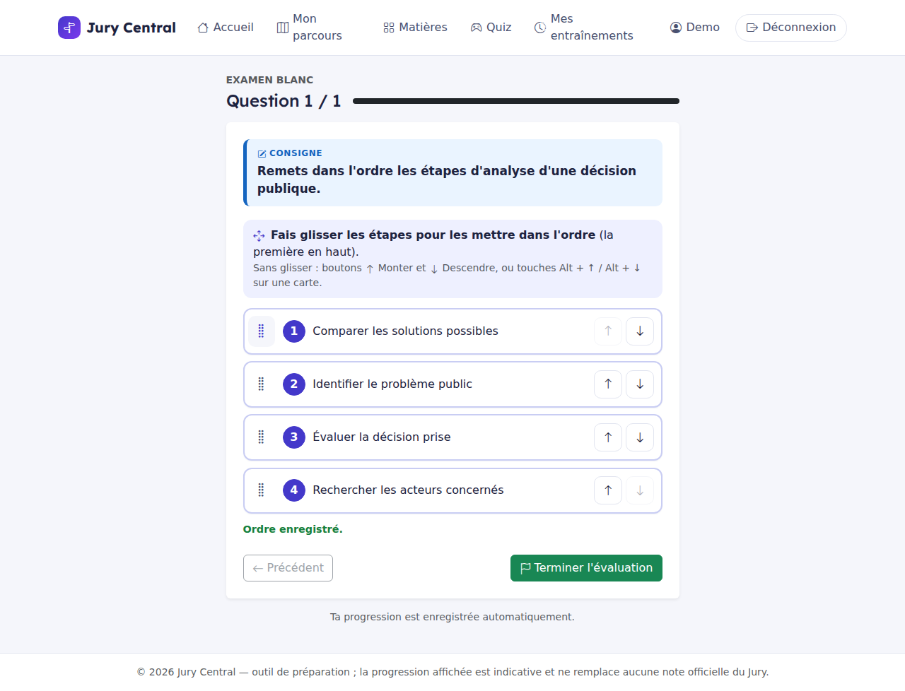
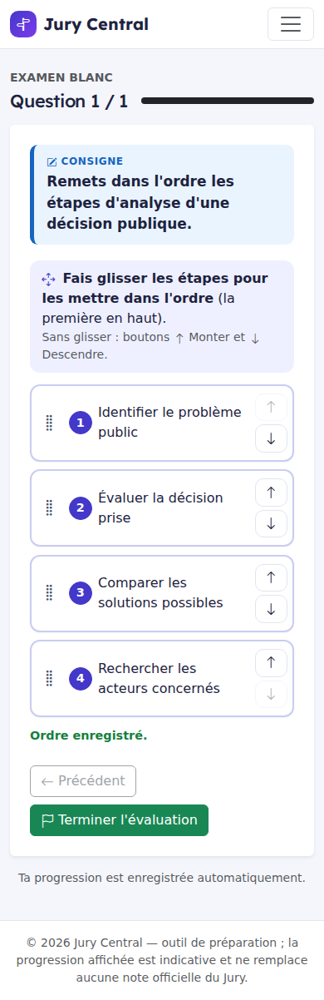

# Ticket #153 — Remise en ordre ludique par glisser-déposer, tactile et clavier

- Ticket : [#153 — P0 — Remise en ordre ludique par glisser-déposer, tactile et clavier](https://github.com/ReC82/jury-central/issues/153)
- **État réel : Installé — à tester**
- **SHA installé : `f11e8b037aaab6a4442c698ff2c392d5f4032dfa`** (fusion de la PR [#167](https://github.com/ReC82/jury-central/pull/167) sur `develop`)
- Branche : `feature/153-ordering-drag-drop`
- Bibliothèque retenue : **SortableJS 1.15.7 — licence MIT** (projet libre et maintenu, souris et tactile natifs, sans dépendance)

## Résultat

Les questions de remise en ordre ne s'affichent plus avec une liste déroulante de positions par élément, mais avec des **cartes réordonnables**. Le même composant sert aux entraînements, aux examens blancs et aux quiz, toutes matières confondues.

Ce que l'élève voit :

- une carte par étape, avec une poignée de déplacement (⋮⋮), un repère de position (1, 2, 3…), le texte en entier et deux boutons ↑ Monter / ↓ Descendre ;
- la consigne « **Fais glisser les étapes pour les mettre dans l'ordre** (la première en haut) », suivie des autres méthodes : boutons Monter/Descendre et, sur ordinateur, Alt + ↑ / Alt + ↓ sur une carte ;
- un retour visuel pendant le déplacement : la place visée apparaît en pointillés, la carte saisie est mise en avant et la carte déplacée clignote brièvement ;
- un état clair :
  - « **Pas encore répondu** : déplace les cartes, ou choisis « Conserver cet ordre » si cet ordre te semble juste. » ;
  - puis « **Ordre enregistré.** », avec les repères de position en couleur ;
  - en cas d'échec réseau : « Ordre choisi, pas encore enregistré : il le sera en passant à une autre question. » ;
- un bouton **« Conserver cet ordre »**, pour accepter l'ordre proposé sans avoir à déplacer une carte inutilement.

Comportements garantis :

- **Ordre de départ mélangé et stable par session.** C'est la permutation existante de #150 (`display_order`), qui n'est jamais l'ordre correct. Il est rejoué à chaque affichage.
- **Pas de réponse silencieuse.** Au chargement, aucune position n'est remplie. Seuls un déplacement ou « Conserver cet ordre » créent une réponse. Passer une question sans répondre reste permis en entraînement et en examen, et ne donne aucun point.
- **Entraînement et examen blanc** : l'ordre est sauvegardé automatiquement, par identifiants stables, dès qu'une carte bouge. La sauvegarde passe par l'API d'autosave existante (`/api/v1/sessions/{id}/answers/{sq}`). Il est repris tel quel après navigation, rafraîchissement ou reconnexion. Déplacer les cartes ne corrige rien, et la réponse du serveur ne contient que `{"saved": true}`.
- **Validation serveur.** L'autosave n'accepte qu'une permutation complète des identifiants de la question, ou un ordre vide (= sans réponse). Un doublon, un élément manquant ou inconnu, ou un format non conforme donne une erreur 422, et la réponse déjà enregistrée reste intacte.
- **Quiz** : pas d'autosave, la validation reste volontaire (« Valider ma réponse »). Si l'élève valide sans avoir bougé de carte ni choisi « Conserver cet ordre », un message l'invite à le faire. Le serveur refuse lui aussi une réponse incomplète, comme avant.
- **Téléphone** : le glisser ne démarre que depuis la poignée, après un court appui (120 ms). Balayer le texte d'une carte fait défiler la page normalement.
- **Clavier et lecteur d'écran** : les boutons Monter/Descendre sont de vrais boutons, et le focus reste sur la carte déplacée. Chaque déplacement est annoncé dans une zone `aria-live`, par exemple « « Comparer les solutions possibles » déplacé en position 2 sur 4. ».
- **Compatibilité** :
  - le contrat de formulaire ne change pas (champs `position__<id>`), donc le moteur, la notation et les anciennes réponses restent tels quels ;
  - aucune migration ni nouvel algorithme de notation ;
  - une ancienne saisie partielle faite avec les listes déroulantes est conservée ;
  - sans JavaScript, les listes déroulantes d'origine restent utilisables.
- **Solution jamais transmise** : `correct_order` n'apparaît jamais dans la page, ce qui est vérifié par les tests.

## Fichiers modifiés

| Fichier | Changement |
|---|---|
| `app/templates/_ordering_cards.html` (nouveau) | Composant partagé : cartes, consigne, état, « Conserver cet ordre », repli sans JS |
| `app/static/js/ordering_cards.js` (nouveau) | Glisser-déposer, Monter/Descendre, Alt + ↑/↓, focus, annonce, autosave, garde de validation du quiz |
| `app/static/vendor/sortablejs/Sortable.min.js` + `LICENSE` (nouveaux) | SortableJS 1.15.7 (MIT), vendorisé : archive npm officielle, SHA-1 vérifié `83a0bddc…0f86` |
| `app/static/css/jc-theme.css` | Styles des cartes (desktop et mobile compact), retours visuels, `prefers-reduced-motion` |
| `app/templates/v1_session_question.html` | Remise en ordre → composant partagé, avec autosave |
| `app/templates/quiz_question.html` | Remise en ordre → composant partagé, sans autosave |
| `app/v1/routes_sessions.py` | `_validated_ordering_autosave` : validation serveur de l'ordre reçu par l'autosave |
| `tests/test_ticket153_ordering_cards.py` (nouveau) | 14 tests |
| `docs/current_state.md` | Paragraphe #153 |

## Liens pour tester (site installé)

Il faut démarrer un entraînement ou un examen blanc d'un cours qui contient des remises en ordre. Les questions sont tirées au hasard dans la banque, donc il peut falloir plusieurs sessions pour tomber sur une remise en ordre.

- MC38 (21 remises en ordre, le plus probable) : https://jury-central.lodylands.com/uaa/ampcr-mc38/exam et https://jury-central.lodylands.com/uaa/ampcr-mc38/practice
- FSE07 : https://jury-central.lodylands.com/uaa/fse-fse07/exam
- FSE01 : https://jury-central.lodylands.com/uaa/fse-fse01/practice
- MC17 : https://jury-central.lodylands.com/uaa/ampcr-mc17/practice
- Quiz : https://jury-central.lodylands.com/quiz

Procédure courte :

1. Sur une question de remise en ordre, vérifier que l'état « Pas encore répondu » s'affiche et que l'ordre proposé n'est pas déjà la solution.
2. Glisser une carte par sa poignée, à la souris puis au doigt sur téléphone. Le message « Ordre enregistré. » apparaît.
3. Sur téléphone, balayer le texte d'une carte : la page doit défiler sans déplacer la carte.
4. Utiliser ↑ / ↓, puis Tab jusqu'à une carte et Alt + ↑ / Alt + ↓ : le focus reste sur la carte.
5. Rafraîchir la page, ou aller à la question suivante puis revenir : l'ordre choisi est conservé.
6. Sur une autre remise en ordre, cliquer sur « Conserver cet ordre » : la question est comptée comme répondue.
7. En quiz, cliquer sur « Valider ma réponse » sans toucher aux cartes : un message invite à agir. Ensuite, la validation montre le feedback habituel.

## Vérifications effectuées

- Tests automatiques :
  - `tests/test_ticket153_ordering_cards.py` (14 tests) ;
  - tests voisins : `test_ticket152_prompt_clarity`, `test_ticket150_quiz_answer_order`, `test_ticket137_quiz`, `test_quiz`, `test_ticket62_hybrid_correction_history_export` ;
  - résultat : **93 passés**. Pas de suite complète : le moteur partagé n'est pas touché, seulement une validation dans la route d'autosave.
- Ce que couvrent les 14 tests :
  - état non répondu au chargement et ordre mélangé de la session ;
  - solution absente de la page ;
  - autosave par identifiants et reprise exacte ;
  - refus des ordres invalides (doublon, manquant, inconnu, entiers, chaîne, positions seules), réponse précédente intacte ;
  - ordre vide = sans réponse ;
  - double sauvegarde (autosave puis navigation) : une seule réponse, score 1 ;
  - navigation sans interaction : 0 point ;
  - ancienne saisie partielle lisible ;
  - autosave refusée une fois la session verrouillée ;
  - quiz sans autosave : validation vide refusée, ordre explicite corrigé.
- `ruff check` sur les fichiers Python modifiés : aucune erreur. `node --check` sur le script : OK.
- **Parcours navigateur réel** (Chromium headless, instance locale jetable avec base temporaire, jamais la base du site) :
  - desktop :
    - glisser à la souris par la poignée : ordre modifié, « Ordre enregistré. », champs de position remplis ;
    - bouton Monter : focus conservé sur ce bouton, annonce « … déplacé en position 2 sur 4. » ;
    - Alt + ↓ : focus conservé sur la carte ;
    - rafraîchissement : même ordre, état répondu ;
    - « Conserver cet ordre » : réponse persistée ;
  - mobile tactile (390 px) :
    - balayer le texte d'une carte fait défiler la page (0 → 204 px), sans réordonner ;
    - appuyer puis glisser sur la poignée réordonne et sauvegarde.
- Installation :
  - les deux services sont `active` ;
  - `/health` est OK en local et en public ;
  - `ordering_cards.js`, `Sortable.min.js`, `jc-theme.css` et `/login` répondent HTTP 200 ;
  - compteurs (utilisateurs / sessions / réponses) : 18 / 71 / 584 avant et après ;
  - sauvegarde de la base faite avant installation.
- **Non vérifié** :
  - un vrai téléphone (iOS Safari / Android Chrome) et un vrai lecteur d'écran (NVDA, VoiceOver) : seul un émulateur tactile Chromium a été utilisé ;
  - le quiz dans le navigateur : il est couvert par les tests serveur, pas par le parcours headless.

Captures (instance de test, données fictives) :

## Choix techniques faits seul

1. **SortableJS 1.15.7 (MIT)** : bibliothèque libre, très utilisée et maintenue, qui gère souris et tactile, sans dépendance et compatible avec la stack (pages serveur Jinja et JS natif, sans build). Elle est **vendorisée** dans `app/static/vendor/` plutôt que chargée depuis un CDN : pas de dépendance réseau tierce, et version figée vérifiée par SHA-1.
2. **Contrat serveur inchangé** (`position__<id>`) : les cartes remplissent des champs cachés. La notation, la correction, les exports et les anciennes réponses n'ont donc pas à changer, et aucune migration n'est nécessaire.
3. **Glisser uniquement par la poignée**, avec un court appui sur écran tactile (120 ms) : le défilement naturel de la page n'est jamais bloqué.
4. **Raccourci clavier Alt + ↑ / Alt + ↓** en plus des boutons : les simples flèches sont laissées au défilement et aux lecteurs d'écran.
5. **Autosave seulement en entraînement et en examen**, avec un léger délai (350 ms) pour regrouper les déplacements rapides. En quiz, la validation reste volontaire, comme le demande le ticket.
6. **Validation de l'ordre dans l'API d'autosave** : le seul point d'entrée qui acceptait jusqu'ici n'importe quel `answer_json` pour une remise en ordre. Le formulaire de navigation était déjà validé par #152.
7. **Mise en page mobile compacte** : une ligne par carte, flèches empilées. Le raccourci clavier n'est pas mentionné sur petit écran.

## Décisions demandées au propriétaire

Aucune décision utilisateur nécessaire.

## Éléments restant à réaliser / signalés (hors périmètre)

- **Exercices interactifs des cours** (`app/static/js/editorial_exercise.js`) : ils ont déjà des boutons ↑/↓ mais pas de glisser-déposer. Ils utilisent un autre protocole (réponse `list[int]`, vérification immédiate). Les adapter au composant serait une petite suite possible, non faite ici pour ne pas toucher à ce moteur distinct.
- **Classification** : elle n'est pas transformée, conformément au ticket. Les listes déroulantes de catégories restent en entraînement et en examen.
- **Sécurité, constat préexistant** : la route `POST /sessions/{id}/answer` et l'API JSON d'autosave ne vérifient pas de jeton CSRF. Ce n'est pas lié à ce ticket ; à traiter dans un ticket dédié si souhaité.
- Validation sur de vrais appareils (iPhone, Android) et avec un lecteur d'écran par le propriétaire.
